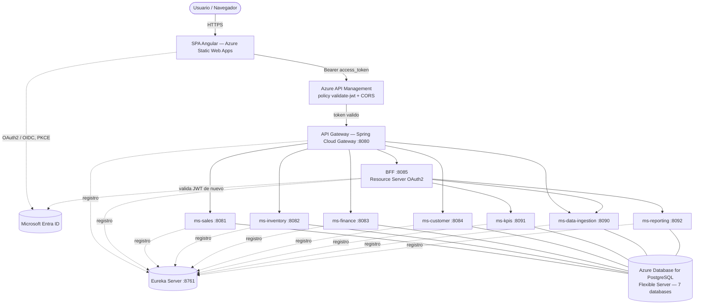
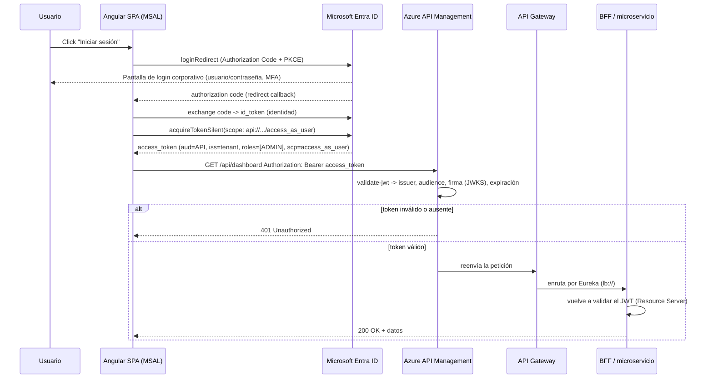

# Informe detallado — Plataforma Grupo Cordillera

> Documento de referencia técnica del proyecto completo (frontend + backend + infraestructura Azure), generado
> 2026-09-22. Cubre arquitectura, stack, autenticación, infraestructura real desplegada y decisiones de diseño.

## 1. Contexto y objetivo

Grupo Cordillera es una plataforma de inteligencia de negocio para un holding con múltiples sucursales. Consolida
datos de **ventas, inventario, finanzas y clientes** en KPIs y reportes para la alta gerencia. El proyecto nace como
un monorepo (React + Spring Boot, autenticación JWT propia, desplegado en AWS) y se migra por completo a:

- **Dos repositorios independientes**: `Backend_Cordillera` (microservicios Spring Boot) y `Frontend_Cordillera`
  (SPA Angular), cada uno con su propio ciclo de vida, historial de commits y despliegue.
- **Autenticación como servicio (IDaaS)**: reemplazo del JWT casero por **Microsoft Entra ID** (OAuth 2.0 /
  OpenID Connect), con autorización basada en App Roles.
- **Infraestructura Azure**: de AWS (EC2 + API Gateway) a Azure (VM + Azure API Management + Azure Database for
  PostgreSQL Flexible Server + Azure Static Web Apps).

Repositorios:

- Backend: https://github.com/FelipeAndresUlloaOtarola/Backend_Cordillera
- Frontend: https://github.com/FelipeAndresUlloaOtarola/Frontend_Cordillera

## 2. Arquitectura general



Todo lo que está a la derecha de API Management corre dentro de una única **Azure VM** (`vm-cordillera-backend`),
como contenedores Docker en la misma red (`cordillera-net`). API Management es el único punto de entrada público
al backend — el gateway interno solo acepta tráfico desde el rango de red permitido en el NSG.

## 3. Stack tecnológico completo

| Capa | Tecnología |
|---|---|
| Frontend | Angular 22 (standalone, signals), TypeScript, Tailwind CSS 4, Vitest |
| Autenticación frontend | `@azure/msal-angular` + `@azure/msal-browser` (OAuth2 Authorization Code + PKCE) |
| Backend | Java 21, Spring Boot 3.5.6, Spring Cloud 2025.0.3 |
| Service discovery | Netflix Eureka Server |
| Gateway interno | Spring Cloud Gateway Server WebFlux (100% reactivo, Netty) |
| Seguridad backend | Spring Security OAuth2 Resource Server reactivo (`NimbusReactiveJwtDecoder`) |
| Persistencia | Spring Data JPA + Flyway, PostgreSQL 16 |
| Resiliencia | Resilience4j (circuit breaker en el BFF) |
| Identidad (IDaaS) | Microsoft Entra ID — tenant single-tenant, App Roles, App registrations SPA + API |
| API Gateway externo | Azure API Management (Consumption), policy `validate-jwt` + CORS |
| Contenerización | Docker, Docker Compose (`docker-compose.yml` dev, `docker-compose.prod.yml` Azure) |
| Hosting frontend | Azure Static Web Apps + GitHub Actions (CI/CD automático) |
| Hosting backend | Azure Virtual Machine (Docker Compose), despliegue manual vía SSH/SCP |

## 4. Autenticación y autorización — flujo completo

### 4.1 Tenant y App registrations (Microsoft Entra ID)

- **Tenant**: `c1d011a7-dcb8-4f4f-b4e4-2ca67388b40f` (`felipeulloalive.onmicrosoft.com`), single-tenant.
- **Cordillera-API** (`6265fd5c-82ab-414c-8c7d-7256766f7940`): expone el scope delegado `access_as_user`
  (`api://6265fd5c-.../access_as_user`) y define dos App Roles: `ADMIN`, `USER`.
- **Cordillera-SPA** (`13b7c04e-c804-4050-8457-84200b9ba1ca`): plataforma **Single-page application** (public
  client, sin secreto), con permiso delegado sobre `Cordillera-API` y admin consent otorgado.

Ninguno de estos Client IDs es secreto: son identificadores públicos del protocolo OAuth2, por eso están como
default en el código (`docker-compose.yml`, `environment.ts`). No hay client secret en ningún punto del sistema:
el SPA es un public client (PKCE) y el BFF solo valida tokens ajenos, nunca los emite.

### 4.2 Usuarios registrados y roles asignados

| Usuario | Rol (App Role) |
|---|---|
| felipe andres ulloa otarola (`felipe.ulloa@live.cl`) | ADMIN |
| dar.moralesa (`dar.moralesa@duocuc.cl`, invitado externo) | ADMIN |
| RODRIGO JARA GONZALEZ (`rodr.jarag@duocuc.cl`, invitado externo) | ADMIN |
| BASTIAN ANDRES SANCHES MUNOZ (`ba.sanches@duocuc.cl`, invitado externo) | ADMIN |

Los tres últimos se agregaron como **usuarios invitados (B2B guest)** vía Microsoft Graph (`POST /invitations`) y
luego se les asignó el App Role `ADMIN` sobre `Cordillera-API` (`POST /users/{id}/appRoleAssignments`).

### 4.3 Flujo end-to-end (login → llamada autenticada)



El token se valida **dos veces**: en el borde (API Management) y en el servicio de negocio (BFF), como defensa en
profundidad — si algún día se expone un microservicio directamente, no queda desprotegido.

### 4.4 Mapeo de claims a autorización

| Claim del JWT | Uso |
|---|---|
| `iss` | Debe ser `https://login.microsoftonline.com/<tenant-id>/v2.0` — valida que el token lo emitió el tenant correcto |
| `aud` | Debe ser el Client ID de `Cordillera-API` — valida que el token fue emitido para esta API |
| `roles` | Array de App Roles (`["ADMIN"]`) → mapeado a `ROLE_ADMIN` en Spring Security |
| `scp` | Scope delegado (`access_as_user`) → mapeado a `SCOPE_access_as_user` |
| `exp` / `nbf` | Vigencia del token, validada por `validate-jwt` en APIM y por el decoder en el BFF |

## 5. Infraestructura Azure (recursos reales desplegados)

Resource Group: **`rg-cordillera`**

| Recurso | Nombre | SKU / Detalle | Región |
|---|---|---|---|
| Virtual Machine | `vm-cordillera-backend` | `Standard_B4ms` (4 vCPU / 16 GiB RAM), Ubuntu + Docker + Docker Compose | East US |
| IP pública VM | — | `74.235.99.148` (estática) | East US |
| Azure Database for PostgreSQL | `cordillera-pg-flex` | Flexible Server, `Standard_B1ms` (Burstable), PostgreSQL 16, 32 GiB | Brazil South |
| Azure API Management | `apim-cordillera` | Tier **Consumption**, `https://apim-cordillera.azure-api.net` | East US |
| Azure Static Web Apps | `swa-cordillera` | Tier **Free**, `https://agreeable-wave-0e10dc60f.2.azurestaticapps.net` | East US 2 |

### 5.1 Seguridad de red (NSG de la VM)

| Regla | Puerto | Acceso | Propósito |
|---|---|---|---|
| `default-allow-ssh` | 22 | Allow | Administración remota (SSH con clave `cordillera-vm`) |
| `allow-gateway` | 8080 | Allow | API Gateway — consumido únicamente por API Management |
| `allow-bff` | 8085 | Allow | BFF — expuesto para health checks / pruebas directas |

Ningún microservicio de dominio (8081-8084, 8090-8092) ni Eureka (8761) tiene puerto abierto a Internet: solo son
alcanzables dentro de la red Docker de la VM, a través del gateway.

### 5.2 Policy de Azure API Management

```xml
<inbound>
    <base />
    <validate-jwt header-name="Authorization" failed-validation-httpcode="401"
                  require-expiration-time="true" require-signed-tokens="true">
        <openid-config url="https://login.microsoftonline.com/<tenant-id>/v2.0/.well-known/openid-configuration" />
        <audiences>
            <audience>6265fd5c-82ab-414c-8c7d-7256766f7940</audience>
        </audiences>
        <issuers>
            <issuer>https://login.microsoftonline.com/<tenant-id>/v2.0</issuer>
        </issuers>
    </validate-jwt>
    <cors allow-credentials="true">
        <allowed-origins>
            <origin>http://localhost:4200</origin>
            <origin>https://agreeable-wave-0e10dc60f.2.azurestaticapps.net</origin>
        </allowed-origins>
        <allowed-methods><method>GET</method><method>POST</method><method>PUT</method>
            <method>DELETE</method><method>OPTIONS</method></allowed-methods>
        <allowed-headers><header>*</header></allowed-headers>
        <expose-headers><header>*</header></expose-headers>
    </cors>
</inbound>
```

`service-url` de la API en APIM apunta a `http://74.235.99.148:8080/api` (el API Gateway interno).

### 5.3 CI/CD

- **Frontend**: GitHub Actions (`.github/workflows/azure-static-web-apps.yml`) — build de Angular con Node 24 en
  cada push a `master`, deploy automático a Azure Static Web Apps vía `Azure/static-web-apps-deploy@v1`.
- **Backend**: despliegue manual — build de la imagen Docker directamente en la VM (`docker compose build`) y
  `docker compose up -d` sobre el servicio modificado, vía SSH con clave dedicada.

## 6. Estructura de los repositorios

### Backend_Cordillera (11 módulos Maven)

```
infraestructure/  eureka-server (8761) · api-gateway (8080) · bff (8085, Resource Server)
core-intelligence/ ms-data-ingestion (8090) · ms-kpis (8091) · ms-reporting (8092)
data-sources/      ms-sales (8081) · ms-inventory (8082) · ms-finance (8083) · ms-customer (8084)
```

### Frontend_Cordillera (Angular standalone)

```
src/app/
├── core/auth/        MSAL config + servicio de sesión (roles/scopes desde el JWT)
├── core/services/     HttpClient hacia cada dominio (sales, customers, kpis, reports, dashboard)
├── layout/             Shell autenticado (sidebar, header)
├── pages/              login (pública), dashboard, sales, customers, not-found
└── app.routes.ts       Rutas públicas vs. protegidas por MsalGuard
```

## 7. Testing

- **Backend**: `mvn test` (JUnit 5, Mockito, JaCoCo). El BFF incluye tests específicos de seguridad: token válido
  → 200, sin token → 401, rol insuficiente → 403.
- **Frontend**: `npm test` (Vitest + Testing Library + jsdom). Cubre guard/interceptor de MSAL y componentes.

## 8. Decisiones de diseño relevantes

- **Defensa en profundidad**: el JWT se valida en dos capas independientes (APIM y BFF) con las mismas reglas
  (issuer, audience, firma, vigencia), para que ningún componente confíe ciegamente en el anterior.
- **Stack 100% reactivo en el borde**: `api-gateway` y `bff` corren sobre WebFlux/Netty (no Tomcat), para sostener
  alta concurrencia con footprint de memoria bajo en la VM compartida.
- **Sin credenciales compartidas**: ni el SPA ni el backend emiten o almacenan contraseñas — toda la identidad la
  gestiona Entra ID, y los microservicios de negocio no tienen lógica de autenticación propia.
- **Un único punto de entrada público**: Azure API Management concentra la validación de borde y el CORS, dejando
  el resto del backend en una red privada solo alcanzable desde la VM.
